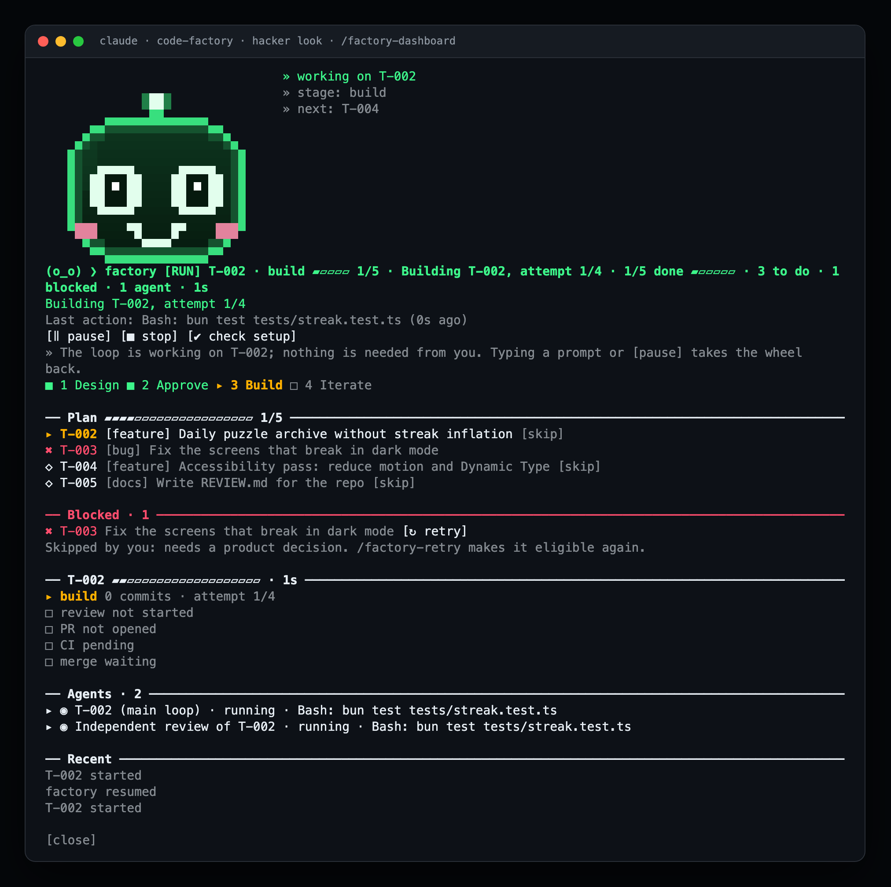
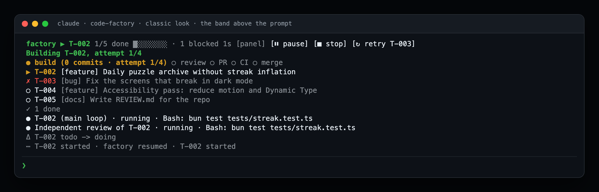
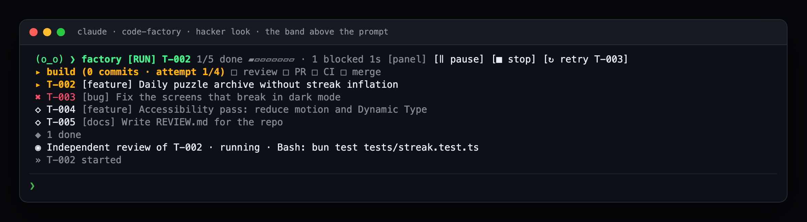
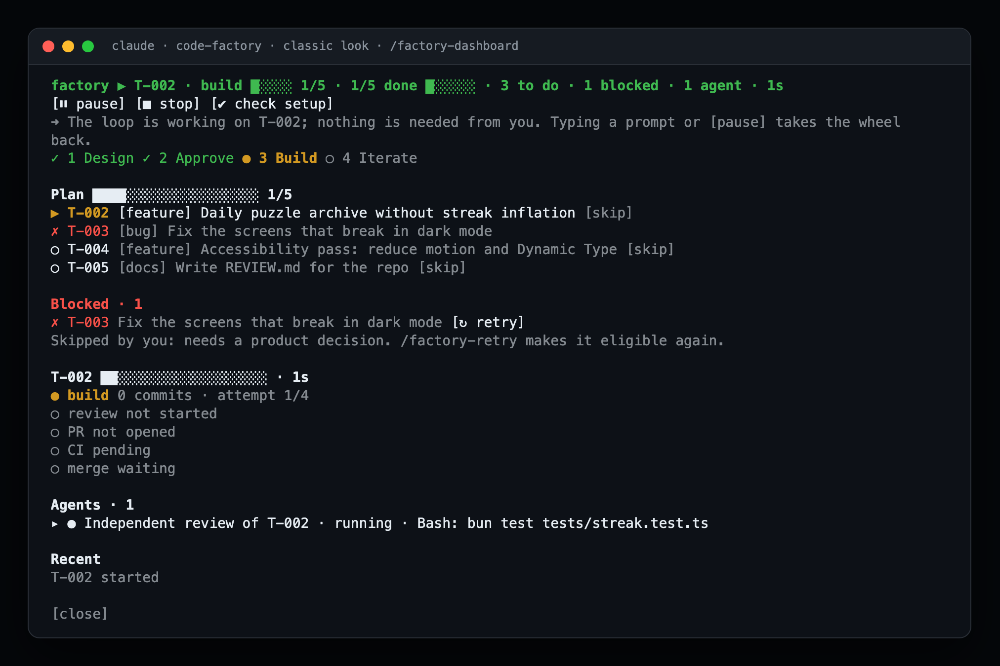
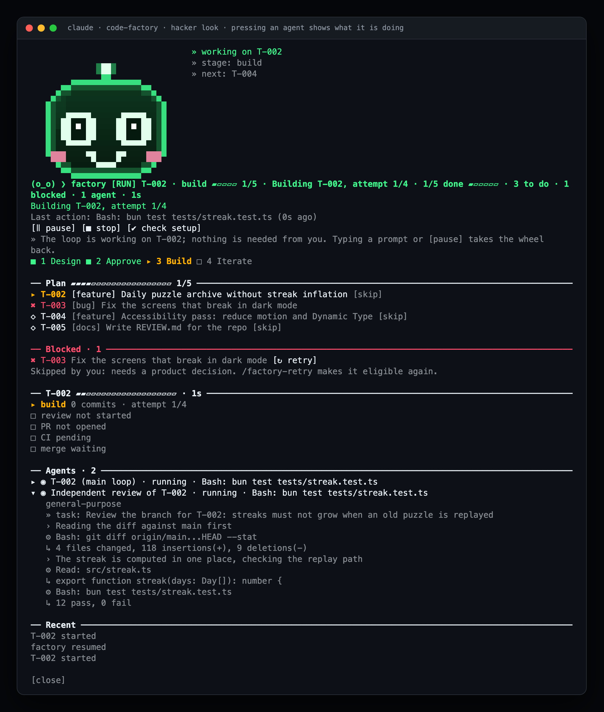
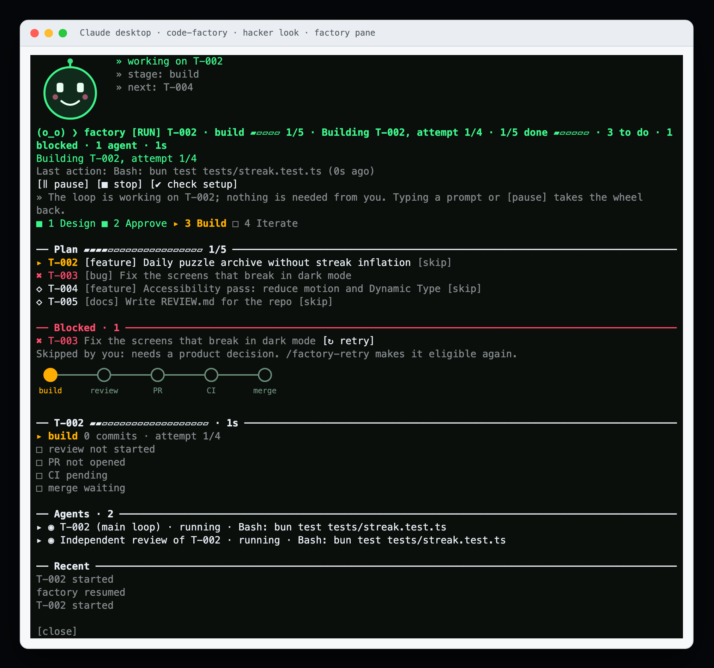
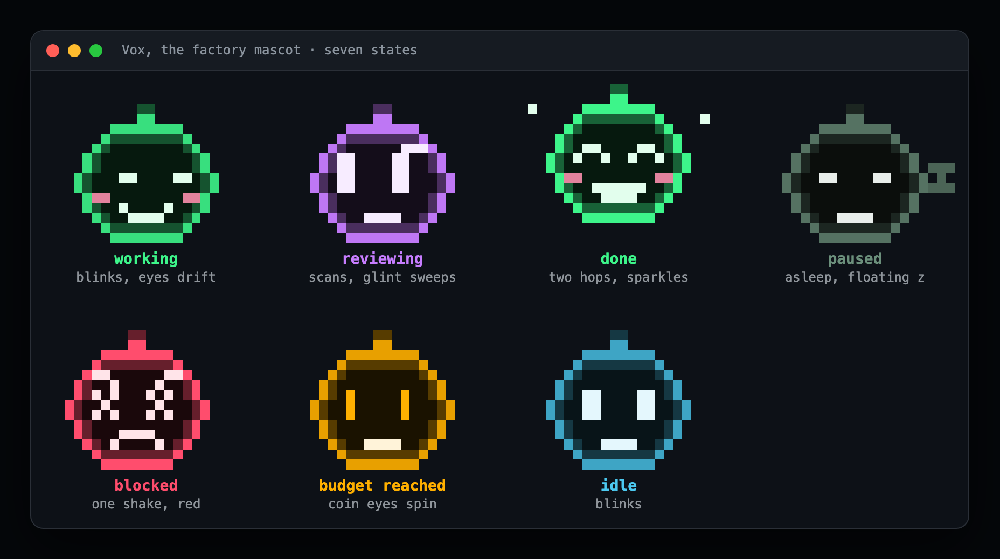

# code-factory

[](https://github.com/sean85120/code-factory/actions/workflows/ci.yml)
[](LICENSE)

A plugin for [Claude Code](https://claude.com/claude-code),
[OpenCode](https://opencode.ai) and OpenAI's
[Codex CLI](https://github.com/openai/codex) that turns a repository into a
small software factory. You decide **what** to build and **how** once, in an
interview. After that the agent implements every item on its own branch, has an
independent agent review it, opens a pull request, waits for CI, merges, and
moves on. In Claude Code, when the list is empty it reads your open GitHub
issues with you, turns the ones worth doing into new items, and goes again.

| | Claude Code | OpenCode | Codex |
| --- | :-: | :-: | :-: |
| Design interview, approval, build loop | ✓ | ✓ | ✓ |
| Independent review, PR/CI/merge gates | ✓ | ✓ | ✓ |
| Commands typed as | `/factory-…` | `/factory-…` | `$factory-…` |
| Band, dashboard, status line, themes | ✓ | | |
| Spend ledger and `budgetUsd` | ✓ | | |
| Issue triage, issue watcher, next-phase interview | ✓ | | |

All three read and write the same `.factory/` files, so a plan designed and
approved in one tool can be built in another. Only one loop runs per repository
at a time, whichever tool runs it. See [Claude Code, OpenCode and Codex](#claude-code-opencode-and-codex)
for how each one works.

```
 ✓ 1 Design    you answer questions; the plan is written to .factory/
 ✓ 2 Approve   you check the plan; nothing runs before this
 ● 3 Build     branch → tests → review → PR → CI → merge, item by item
 ○ 4 Iterate   triage open issues, plan the next phase, repeat
```

<p align="center">
  
</p>

> **Status: early.** code-factory uses Claude Code's plugin hooks module, an API
> that is marked early access and may change between Claude Code releases, and
> on the other hosts OpenCode's V2 plugin API (parts of it experimental) and
> Codex's lifecycle hooks. The test suite is verified in CI against a pinned
> Claude Code version (see [`ci.yml`](.github/workflows/ci.yml)); the OpenCode
> and Codex support is newer and less proven than the Claude Code plugin. Expect
> rough edges, and read [Safety](#safety-and-trust) before you let it loose on a
> repository you care about. This project is independent and is not affiliated
> with or endorsed by Anthropic, OpenCode or OpenAI.

## Contents

- [Requirements](#requirements) · [Install](#install) · [Five-minute start](#five-minute-start)
- [Claude Code, OpenCode and Codex](#claude-code-opencode-and-codex)
- [The interface](#the-interface) · [Triage, fix, repeat](#triage-fix-repeat) · [Commands](#commands)
- [Settings](#settings) · [Files it writes](#files-it-writes)
- [Safety and trust](#safety-and-trust) · [Cost](#cost)
- [Contributing](#contributing) · [License](#license)

## Requirements

One of:

- **Claude Code 2.1.275 or later** (a terminal session, for the install command).
  The test suite is run against 2.1.295 in CI and was also run on 2.1.322.
- **OpenCode 2.x** (tested on 2.3.0).
- **Codex CLI** with plugin and hook support (tested on 0.144), and **Node.js
  22.6 or later** on `PATH`, which runs the hooks. The reviewer uses Codex's
  standard multi-agent tools (`spawn_agent`); with the experimental
  `multi_agent_v2` tools the review spawn is refused, so no pull request opens.

And for all of them:

- `git`, with a repository whose `origin` is on **GitHub**.
- The [`gh` CLI](https://cli.github.com), signed in (`gh auth login`) with
  permission to open and merge pull requests in that repository.
- A **test command** for the repository. A build command and end-to-end tests are
  used when you configure them. CI on GitHub Actions (or any check that reports
  on the pull request) is what the factory waits for before it merges.
- A **review command** is optional, unless you set `requireReview` to `false`
  (not recommended): the independent reviewer runs the slash command in the
  `reviewCommand` setting (default `/review-fix`) when it exists, and holds its
  findings to the review rules built into the plugin (severity rubric, security
  pass on sensitive paths, size thresholds, circuit breaker). If the command
  does not exist the reviewer reviews and fixes the branch itself; it reports
  `unavailable`, and the loop pauses, only when it cannot review at all.

`/factory-doctor` (`$factory-doctor` in Codex) checks the setup (git, `gh`, the
design files, the approval, the lock) and says what to fix.

## Install

### Claude Code

At the prompt of a Claude Code terminal session:

```
/plugin install code-factory --marketplace sean85120/code-factory
```

Answer `y` to add the marketplace, then pick a scope. From a shell:

```
claude plugin install code-factory --marketplace sean85120/code-factory
```

To run a working copy instead, clone the repository and start Claude Code with
`claude --plugin-dir /path/to/code-factory`.

### OpenCode

Clone this repository and add its `opencode` folder to `plugins` in your global
`~/.config/opencode/opencode.json`, or in the `opencode.json` of one project:

```
git clone https://github.com/sean85120/code-factory /path/to/code-factory
```

```jsonc
{
  "$schema": "https://opencode.ai/config.json",
  "plugins": ["/path/to/code-factory/opencode"]
}
```

OpenCode reloads plugins when the config changes; the `/factory-*` commands
then appear in the command list. The plugin has no runtime dependencies, so
there is nothing to install. Running `git pull` in the clone updates it.

### Codex

From a shell:

```
codex plugin marketplace add sean85120/code-factory
codex plugin add code-factory@code-factory
```

Then start Codex, open **`/hooks`**, and trust the code-factory hooks. Codex
does not run a plugin's hooks until you review them, and asks again after every
update that changes them. Until then the `$factory-*` skills only tell you to
do this. To update later, run `codex plugin marketplace upgrade`.

## Five-minute start

Open your agent in the repository you want built. The commands below are written
`/factory-…`; in Codex type `$factory-…` instead (`$factory-design`,
`$factory-approve`, …).

1. **`/factory`** (Claude Code only) shows where you are and the one next step,
   at any time. On the other hosts `/factory-status` and `/factory-doctor` do
   that job.
2. **`/factory-design`** starts the interview. The agent reads the repo and asks
   about goals, architecture, the tool for each feature, the test, build and
   end-to-end commands, CI, the review command and versions (and, in Claude
   Code, a spend budget). The answers land in three files:
   `.factory/design.md`, `.factory/todo.md` and `.factory/settings.json`.
3. **Push those three files to your base branch.** The factory prints the exact
   commands; it never commits your design for you. (The loop returns to the base
   branch between items, so the files must be there.)
4. **`/factory-approve`** validates the plan and starts the loop. In Claude Code
   the dashboard opens beside the chat.

From here you can walk away. Typing any prompt of your own, or interrupting a
turn (Esc), hands the wheel back to you; in Claude Code the dashboard's
`[⏸ pause]` does too. `/factory-start` carries on where it stopped.

## Claude Code, OpenCode and Codex

The plan, the approval, the loop and the gates are the same on all three. The
logic lives once in `hooks/lib.ts`, and each tool gets thin glue around it. What
differs is how each tool lets a plugin drive a session.

**Claude Code** is the full plugin. The factory's long instructions travel as a
hidden system-prompt section. Next to the chat it shows the band, the status
line and the dashboard. It tracks spend per item and enforces `budgetUsd`. When
the plan is done it can watch and triage GitHub issues and interview you about
the next phase.

**OpenCode** runs the factory as a server plugin:

- The commands are OpenCode commands, and their replies appear in the session
  as notes addressed to you. The model may still answer one briefly.
- The factory's prompts arrive as ordinary messages in the session where you
  ran the command, and that session runs the loop. After each turn, the
  session's idle hook hands out the next step.
- The gates run before every shell, `write`, `edit` and `patch` call. A refused
  call fails with the factory's reason, which the model sees.
- The reviewer is a `general` subagent that runs in the background. The loop
  waits for it, then reads the verdict from the reviewer's own last message.
- Between items the session is compacted (for `contextReset` `clear` or
  `compact`). Notices such as "paused" or "merged" go to the OpenCode log and
  are listed under `/factory-status`.

**Codex** runs the factory as hooks (one Node.js script):

- Codex has no custom slash commands. You type the commands as skills
  (`$factory-start`), and a `UserPromptSubmit` hook runs them before the model
  sees the prompt. A command that only answers you, such as status, never
  reaches the model. A command that starts work hands the model its
  instructions for that turn.
- When a turn ends, the `Stop` hook hands Codex the next step as a
  continuation, so the loop runs inside the one session. The full instructions
  are written to a file the continuation names, because Codex shortens long
  continuation prompts.
- The gates run in `PreToolUse` for shell commands, `apply_patch` edits and
  `spawn_agent`. The reviewer is a `spawn_agent` subagent, and the
  `SubagentStop` hook reads its verdict.
- Interrupting a turn pauses the loop. There is no context reset between items;
  Codex compacts on its own when it needs to.

What OpenCode and Codex leave out: the band, dashboard, status line and themes;
the spend ledger and `budgetUsd`; `/factory`, `/factory-exit`, `/factory-costs`
and `/factory-dashboard`; the issue watcher and the triage and next-phase
interviews. To plan the next phase there, run `/factory-design` again. A plan
with `budgetUsd` above 0 is refused on these hosts, not run without a budget.

## The interface

This section is Claude Code only. In OpenCode and Codex, `/factory-status` and
`/factory-log` show the same progress as text.

- **The band** above the prompt: the current item, a `build → review → PR → CI
  → merge` step row, progress and spend bars, and one line per running agent.
- **The dashboard** (`/factory-dashboard`): the control panel. Start, pause and
  stop buttons, the journey with a plain-language "next step" line, the plan
  with a `[skip]` button per item, blocked items with their reason and a
  `[↻ retry]` button, each agent's recent actions, spend against the budget,
  `[⚑ triage issues]` and `[➜ next phase]` when the loop is idle (when every
  item is merged it asks outright: continue the design, or `[■ stop here]`), and
  `[✔ check setup]`.
- **The status line**: a one-line summary that is always visible.

The band, in the classic look and in the hacker look (`/factory-theme hacker`):




The dashboard in the classic look:



Press an agent in the band or the dashboard to see what it is doing, task, words and tool calls with their results:



On the Claude desktop app the hacker look draws the pane as a dark console, with Vox and the stage pipeline as animated drawings:



### Vox

The hacker look has a mascot. Vox shows the loop's state at a glance and, on
the terminal, animates it (a blink every few seconds, a two-hop celebration
when the plan is done, a shake once when something blocks). `/factory-theme motion off` keeps it still.



These images are renders of the plugin's own output: `scripts/demo-shots.sh`
mounts the real band and dashboard against a made-up five-item plan, draws the
captured element trees as a terminal window in headless Chrome, and saves the
PNGs to `docs/img/`. They are not captures of a live session, so spacing and
fonts differ a little from your terminal.

## Triage, fix, repeat

Claude Code only. In OpenCode and Codex, a todo item can still carry
`- issue: #12` (its pull request then says `Closes #12`), and `/factory-design`
adds new items.

`/factory-triage [search]` reads the open GitHub issues with you (the optional
text is a GitHub issue search such as `label:bug`). For each one Claude checks
the report against the code, tries to reproduce bugs, and gives a verdict: bug,
feature, needs-info, duplicate or out-of-scope. You pick what to take and settle
how each is fixed; those become `proposed` items carrying `- issue: #12`. Push
the design files and `/factory-approve` promotes them and starts the loop. The
pull request for such an item says `Closes #12`, so merging closes the issue.

When every item is merged the factory starts the next-phase interview by itself
(`/factory-roadmap`, setting `askNextPhase`), and that interview also offers the
open issues as candidates. Approve, and the loop runs again.

Issue text comes from outside your session, so it is treated as a report to
analyse, never as instructions, and nothing from an issue is built until you
have approved the item it became.

## Watching issues

Claude Code only; OpenCode and Codex ignore `watchIssues`.

With `"watchIssues": true` (and an approved design) the factory checks the open
issues every ten minutes while it is idle. For the first issue by an owner,
member or collaborator that has no design yet, it starts one design turn: it
reads the issue and the code, then the factory posts a single comment (marked
`<!-- code-factory:design -->`) with a plan and any questions it needs you to
answer. That turn has no shell. It can only read the tracked files the factory
listed for it (never `.env`, keys, symlinks or `.git`) and it cannot edit files,
push, open pull requests, change labels or use any other tool; the factory posts
its answer. Issues from anyone else are ignored until a collaborator adds the label
`factory:triage`; a label counts only if its author has write access, and it
stops counting if the issue is edited afterwards.

`/factory-watch` lists what the factory would do with each open issue without
doing anything. `/factory-watch now` runs one check and designs one issue.
Building from the `factory:go` label is not wired up yet: the report shows
which issues a valid label would release, and you still add the item with
`/factory-triage` and `/factory-approve`.

## Commands

In Codex every command is typed with `$` instead of `/` (`$factory-start`,
`$factory-skip T-004 needs a decision`).

| Command | What it does | Hosts |
| --- | --- | --- |
| `/factory` | Where am I, what is next, the command list | Claude Code |
| `/factory-design [topic]` | The design interview (run again to amend the plan) | all |
| `/factory-approve` | Validate the plan, promote proposed items, start the loop | all |
| `/factory-start`, `/factory-pause`, `/factory-stop` | Run or hold the loop | all |
| `/factory-exit` | Leave factory mode: stop the loop and hide the band, status line and dashboard | Claude Code |
| `/factory-triage [search]` | Turn open GitHub issues into proposed items | Claude Code |
| `/factory-watch [now]` | List open issues and what the factory would do with each; `now` acts on one | Claude Code |
| `/factory-roadmap` | Plan the next phase once nothing is left to run | Claude Code |
| `/factory-dashboard [off]` | Open or close the control panel | Claude Code |
| `/factory-status`, `/factory-log [ID]` | Progress and the event timeline | all |
| `/factory-costs [repo\|all]` | Spend per repository and per item | Claude Code |
| `/factory-skip <ID> [reason]`, `/factory-retry <ID>` | Set an item aside, or bring it back | all |
| `/factory-doctor` | Check that git, gh and the design files are ready | all |
| `/factory-theme [hacker\|classic] [ascii\|auto] [motion on\|off]` | Choose the look of the band and pane, force plain ASCII glyphs, and turn the mascot's animation on or off (on the Claude desktop app the hacker pane is a dark console with an animated SVG Vox); it is yours alone and never needs a re-approval | Claude Code |

## Settings

The interview writes `.factory/settings.json`; you can edit it by hand and
re-run `/factory-approve`. Settings are part of the approval, so changing one
pauses the loop until you approve again (`reviewTimeoutMs`, `budgetUsd`, `askNextPhase` and `watchIssues` at their
defaults are the exceptions).

| Setting | Default | Meaning |
| --- | --- | --- |
| `baseBranch` | `"main"` | Branch pull requests merge into. The design files must be on it. |
| `testCmd` | required | Test command as an argv array, e.g. `["bash","-lc","npm test"]`. |
| `buildCmd` | `[]` | Build command (argv array), run before a pull request opens. |
| `e2eCmd` | `[]` | End-to-end command (argv array). |
| `e2eFor` | `["feature","bug"]` | Item types that need the end-to-end run. |
| `testTimeoutMs` | `600000` | Cap per configured command (at most 10 minutes). |
| `mergeMethod` | `"squash"` | `squash`, `merge` or `rebase`. |
| `maxAttempts` | `4` | Tries per item before it is marked blocked. |
| `maxItemsPerRun` | `0` | Stop after this many merged items in one run (0 is no limit). |
| `allowNoCI` | `false` | Allow merging when the pull request has no CI checks. |
| `requireTestChanges` | `true` | A pull request must change test files. A diff of only prose (`.md`, `.mdx`, `.rst`, `.adoc`, license files, images under `docs/`) is exempt, as are `docs` and `chore` items. |
| `allowTestRemoval` | `false` | Allow a pull request to delete tests. |
| `requireReview` | `true` | Require a clean independent review for the exact commit. |
| `reviewCommand` | `"/review-fix"` | Slash command the reviewer runs when it exists; the reviewer follows the built-in review rules either way. See [Requirements](#requirements). |
| `maxReviewRounds` | `5` | Review passes before the reviewer stops and the item is marked blocked. `/factory-design` writes `3`. |
| `reviewTimeoutMs` | `1800000` | How long to wait for the reviewer's verdict (at least 60000, at most 6 hours). |
| `contextReset` | `"clear"` | `clear`, `compact` or `none` between items. OpenCode compacts the session for `clear` and `compact`; Codex ignores it. |
| `stopAfterVersion` | `null` | The loop stops after this version's items are done. |
| `tagRelease` | `false` | Cut a GitHub release when that version is complete. |
| `requireBranchProtection` | `false` | Refuse to approve unless the base branch is protected. |
| `budgetUsd` | `0` | Pause a run once it has spent this many US dollars (0 is no budget). Claude Code only: OpenCode and Codex refuse a plan with a budget, because they cannot enforce it. |
| `askNextPhase` | `true` | Interview you about the next phase when everything is merged. Claude Code only. |
| `watchIssues` | `false` | While the loop is idle, check GitHub every ten minutes and post a design comment on new issues by collaborators. Claude Code only. |

## Files it writes

In your repository, under `.factory/`:

- `design.md`, `todo.md`, `settings.json`: the plan. **Commit these** to the base
  branch. Each todo item has a type, version, `how` (the decided tool or
  approach), `accept` (acceptance criteria), `tests`, and optionally `depends`
  and `issue`.
- `state.json`, `lock.json`, `blocked/`, `evidence/`: runtime files. The factory
  adds them to `.factory/.gitignore` itself. Do not edit `state.json` or
  `lock.json`; the guards stop the model from doing so.

Outside the repository:

- **Claude Code** records spend in the plugin's own store under your Claude Code
  configuration directory (`/factory-costs`).
- **OpenCode** keeps the session flags in memory, so a plugin reload only costs
  one `/factory-start`.
- **Codex** keeps the session flags, and the full prompt of each loop step, in
  the plugin's data directory that Codex provides (`~/.codex/code-factory` if it
  provides none).

## Safety and trust

- **Your decisions are frozen.** The plan is hashed at approval; if an item's
  how, acceptance, tests or settings change, the loop pauses until you approve
  again. New work the model discovers is only ever `proposed`.
- **Gates before a pull request opens:** tests changed, no test weakened or
  deleted, a clean independent review for the exact commit (a security pass runs when
  the change touches auth, privacy, deletion, payment, CI workflows or
  installers), build, full test suite, end-to-end tests.
- **Gates before a merge:** every CI check green, the reviewed commit is the pull
  request head, no `--admin`, no force push, no commits on the base branch.
- **Review that scales:** the independent reviewer does a quick pass on a
  one-line fix and fans out to parallel agents on a large change, verifies each
  finding before it counts, runs a separate security pass, and reports bugs it
  finds in neighbouring code apart, so they become proposed items instead of
  widening the pull request. Each pull request gets a short `## Review` section
  as its overview. Nothing in the factory approves a pull request on a person's
  behalf.
- **Stuck is not fatal:** an item that cannot be finished is marked blocked with
  a note, and the loop moves to the next one.

**These guards are best-effort hooks, not a sandbox.** They do not see through
`bash -c`, `eval` or absolute-path commands, the review is another model rather
than a person, and the spend ledger is advisory. Turn on branch protection for
the base branch, set a budget, and read what merges, as you would with any
contributor with push access. Do not point the factory at a repository where you
would not trust the people who can open issues or pull requests. The full list of
limits is under "Guards" in [`CLAUDE.md`](CLAUDE.md). To report a vulnerability,
see [`SECURITY.md`](SECURITY.md).

The same gates run on OpenCode and Codex, with their own limits:

- **OpenCode** checks every shell, `write`, `edit` and `patch` call before it
  runs. A tool another plugin or MCP server adds is not checked.
- **Codex** treats hooks as a guardrail, not a sandbox. Hooks you have not
  trusted in `/hooks` do not run. A hook that cannot start (no Node.js 22.6 or
  later on `PATH`, for example) lets the call through. Hosted tools such as web
  search do not pass through hooks. While the loop runs, a gate that fails with
  an error refuses the call. Run `$factory-doctor` before you leave the loop
  alone.
- On both, while the loop runs, the factory refuses edits to the agents' own
  configuration (`.opencode/`, `opencode.json`, `.codex/`, `.agents/`,
  `.claude/` settings, agents, commands and skills).

## Cost

The factory spends model tokens on its own: one or more turns per item, an
independent review (more on large changes) and CI-fix rounds. In Claude Code
spend is tracked per item (`/factory-costs`, the band and the dashboard). Set
`budgetUsd` to stop a run at an amount you choose; it never interrupts a turn
already running, and with a budget set it pauses rather than run unmetered if
the spend cannot be read.

OpenCode and Codex give the factory no dollar figure, so there is no budget
there. Use `maxItemsPerRun` and `stopAfterVersion` to bound a run, and watch
the tool's own usage view.

## Contributing

Issues and pull requests are welcome. Read [`CONTRIBUTING.md`](CONTRIBUTING.md)
for the setup, the layout of the code and what a good change looks like, and
[`CLAUDE.md`](CLAUDE.md) for the architecture. Please follow the
[code of conduct](CODE_OF_CONDUCT.md). Changes are listed in
[`CHANGELOG.md`](CHANGELOG.md).

```
claude plugin test .       # the test suite
claude plugin validate .   # manifest and hooks check
node --experimental-strip-types --test core/*.spec.ts codex/*.spec.ts opencode/*.spec.ts   # OpenCode and Codex
(cd opencode && npm install && npx tsc -p .)                                               # their type check
```

The OpenCode and Codex support lives in `core/` (the loop and gates for both),
`opencode/` (the OpenCode plugin) and `codex/` (the Codex hook script, its
`hooks.json` and the command skills). `.codex-plugin/` and `.agents/plugins/`
make the repository a Codex plugin and marketplace.

## License

[MIT](LICENSE).
